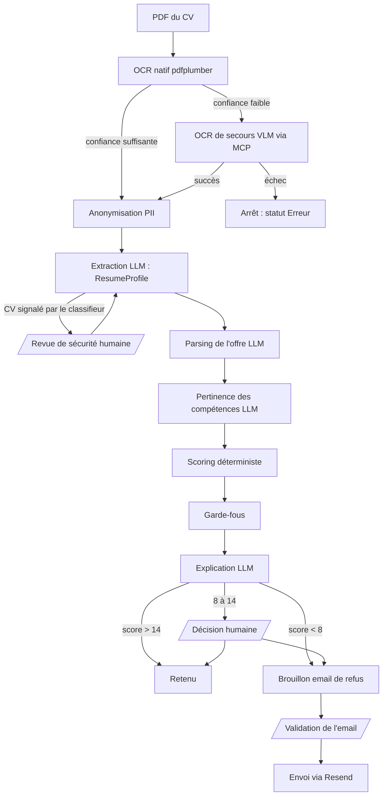

# Tri de CV assisté par IA (PFE)

Application de présélection de candidatures qui analyse des CV (PDF), les compare à une offre d'emploi, calcule un score sur 20 et explique le résultat. **Le recruteur garde toujours la décision finale** : les cas ambigus et tout envoi d'email passent par une validation humaine.

Un second profil (étudiant) permet de chercher des offres à l'étranger et d'obtenir un rapport d'amélioration de son CV.

> Statut : projet de fin d'études. Outil d'aide à la décision, pas un système de recrutement automatique.

---

## Fonctionnalités

**Profil recruteur**
- Vivier de CV (import PDF, import depuis une boîte mail IMAP)
- Gestion des offres par domaine
- Analyse automatique : extraction, score sur 20, explication en français
- Classement des candidats par offre, recherche de profils similaires
- Zone grise (score entre 8 et 14) : décision humaine « shortlister / rejeter »
- Brouillon d'email de refus, relu et validé par le recruteur avant envoi
- Dossier de synthèse PDF pour les candidats retenus
- Avis 👍/👎 pris en compte pour recalibrer les poids du score

**Profil étudiant**
- Recherche d'offres (Adzuna, Arbeitnow)
- Rapport d'amélioration du CV pour une offre précise
- Génération d'une lettre de motivation

---

## Architecture

Le pipeline est un graphe LangGraph avec points d'arrêt humains.



**Principes de conception**
- **Le LLM ne décide jamais.** Il extrait et explique. Le score est calculé par du code déterministe (`nodes/matching_scoring.py`), donc auditable.
- **Un seul nœud voit le texte du CV** (l'extraction). Les nœuds suivants reçoivent des données structurées.
- **Échec ouvert côté pipeline, fermé côté décision** : un échec technique (OCR, LLM) produit un statut « Erreur », jamais un faux score ou un faux « Retenu ».

---

## Calcul du score

Score final = modèle pondéré (poids apprenables) appliqué à quatre indicateurs, ramené sur 20 :

| Indicateur | Description |
|---|---|
| Similarité sémantique | Embeddings `paraphrase-multilingual-MiniLM-L12-v2` (repli : Bag of Words) |
| Recouvrement des compétences | Jugement du LLM (nœud `skill_relevance`), repli sur correspondance par mots-clés |
| Expérience | Score continu : 1 si le minimum est atteint, pénalité douce en dessous |
| Filtres obligatoires | Certifications requises |

Seuils de routage : `> 14` retenu, `< 8` refus, entre les deux revue humaine.

Les poids sont mis à jour à partir des avis du recruteur (`rl/`).

---

## Sécurité et confidentialité

| Mesure | Détail |
|---|---|
| Classifieur anti-injection | Modèle local XLM-RoBERTa multilingue, appliqué au texte brut du CV. Si le texte est signalé, le recruteur le vérifie avant tout appel au LLM |
| Encadrement du contenu non fiable | Balises `<untrusted_document>` + rappel de tâche, et échappement du balisage |
| Validation des sorties | Les sorties JSON du LLM sont validées (JSON valide, clés attendues) ; sinon repli sans blocage |
| Validation humaine | Zone grise et tout email de refus |
| Anonymisation (PII masking) | Email, téléphone, URL, âge, genre, adresse et nom masqués avant l'extraction LLM. L'identité est réinjectée après |
| Authentification | Deux rôles (recruteur, étudiant). Mots de passe hachés (PBKDF2-SHA256 + sel), comparaison en temps constant, aucun mot de passe en dur |
| Secrets | Dans `.env`, jamais commités |
| Droit à l'effacement | Un candidat peut être retiré : son fichier CV et ses résultats sont supprimés |

### Limites à connaître

- **Fallback VLM :** pour un CV scanné, la page entière (y compris photo et coordonnées) est envoyée à une **API externe** (Groq). Le chemin natif reste 100 % local. Le fallback peut être désactivé.
- **Anonymisation :** elle réduit le biais mais ne l'élimine pas (école, parcours, loisirs). Le nom est détecté par NER et peut produire des faux positifs ou négatifs. `À COMPLÉTER : résultats du test d'équité`
- **Classifieur :** il peut produire des faux positifs sur des CV légitimes. `À COMPLÉTER : précision / rappel mesurés`
- **Mode test email :** avec le plan gratuit de Resend, les emails ne peuvent partir que vers l'adresse du compte. La variable `EMAIL_TEST_RECIPIENT` redirige donc tous les envois. Pour envoyer aux vrais candidats, il faut vérifier un domaine sur Resend.
- **Authentification :** adaptée à une démonstration (pas de verrouillage après échecs répétés, pas de réinitialisation de mot de passe). Une mise en production demanderait un fournisseur d'identité.
- **Stockage :** fichiers JSON locaux dans `data/`, sans écriture atomique. À remplacer par une base de données en production.
- **Échelle du score :** la sigmoïde borne le score final entre environ 3,6 et 16,4 sur 20. Les seuils de routage (8 et 14) sont calibrés sur cette plage.
- **Apprentissage par avis :** les avis du recruteur ajustent les poids ; ils peuvent donc transmettre ses propres biais au modèle.
- **Checkpoints en mémoire :** les analyses en pause sont perdues si l'application redémarre. Il faut alors cliquer sur « Réinitialiser » et relancer l'analyse.

---

## Observabilité

Les appels LLM et les nœuds du graphe sont tracés avec **Langfuse auto-hébergé** (Docker), donc les traces restent sur la machine. Les durées `ocr_seconds` et `vlm_seconds` permettent de comparer l'OCR natif et le fallback VLM.

Attention : les traces contiennent l'état des nœuds, donc le texte des CV. Ne pas utiliser Langfuse cloud sans masquer les entrées.

---

## Stack technique

Python, Streamlit, LangGraph, Ollama (`qwen2.5:7b`), sentence-transformers, Hugging Face Transformers (classifieur), spaCy, pdfplumber, PyMuPDF, MCP, Groq (VLM de secours), Resend, reportlab, Langfuse, Pydantic.

---

## Structure du projet

```
selection_cv/
├── app.py                  # interface Streamlit
├── core/
│   ├── graph.py            # définition du graphe LangGraph
│   ├── state.py            # schémas Pydantic et état du pipeline
│   ├── pipeline_runner.py  # pauses, reprises, statuts normalisés
│   └── llm_client.py       # client LLM (compatible OpenAI / Ollama)
├── nodes/                  # ocr, anonymize, extraction, jd_parsing,
│                           # skill_relevance, matching_scoring, guardrails,
│                           # explanation, rejection_email, human_review
├── security/
│   └── prompt_injection_guard.py
├── prompts/                # prompts système et exemples
├── services/               # auth, data_store, cv_advisor, job_search,
│                           # mail_ingest, summary_pdf
├── rl/                     # avis recruteur et mise à jour des poids
├── mcp_servers/
│   └── ocr_mcp_server.py   # outil OCR (VLM) exposé via MCP
├── ui/                     # fonctions utilitaires de l'interface
├── data/                   # données locales (ignoré par git)
└── tests/                  # À COMPLÉTER
```

---

## Installation

Prérequis : Python 3.11, [Ollama](https://ollama.com), Docker Desktop (optionnel, pour Langfuse).

```bash
git clone <URL_DU_DEPOT>
cd selection_cv
python -m venv venv
venv\Scripts\activate          # Windows
pip install -r requirements.txt
python -m spacy download fr_core_news_md
ollama pull qwen2.5:7b
```

Par défaut, Ollama utilise un contexte de 4096 tokens, trop court pour un prompt d'extraction avec un CV de deux pages (troncature silencieuse). Créer un modèle avec un contexte plus large :

```powershell
"FROM qwen2.5:7b`nPARAMETER num_ctx 8192" | Set-Content Modelfile
ollama create qwen2.5-cv -f Modelfile
```

Puis renseigner `LLM_MODEL=qwen2.5-cv` dans `.env`. Vérifier avec `ollama ps` que la colonne `CONTEXT` affiche 8192.

Le modèle du classifieur anti-injection et le modèle d'embeddings sont téléchargés automatiquement au premier lancement (connexion internet requise une fois).

### Configuration

Copier `.env.example` en `.env` et renseigner les valeurs :

```
# Comptes de démonstration (si vides, un mot de passe aléatoire est généré
# et affiché une seule fois dans la console au premier lancement)
DEMO_RECRUITER_PASSWORD=
DEMO_STUDENT_PASSWORD=

# Modèle de langage (Ollama par défaut)
LLM_BASE_URL=http://localhost:11434/v1
LLM_MODEL=qwen2.5-cv
LLM_API_KEY=ollama
LLM_TIMEOUT_SECONDS=180

# Email (Resend)
RESEND_API_KEY=
RESEND_SENDER_EMAIL=onboarding@resend.dev
EMAIL_TEST_RECIPIENT=          # mode test : redirige tous les envois

# Import des CV par boîte mail (IMAP, mot de passe d'application)
IMAP_HOST=imap.gmail.com
IMAP_USER=
IMAP_PASSWORD=

# OCR de secours (VLM)
QWEN_VLM_URL=https://api.groq.com/openai/v1/chat/completions
QWEN_VLM_API_KEY=
QWEN_VLM_MODEL=
QWEN_VLM_TIMEOUT_SECONDS=60

# Recherche d'offres
ADZUNA_APP_ID=
ADZUNA_APP_KEY=

# Observabilité (Langfuse auto-hébergé)
LANGFUSE_PUBLIC_KEY=
LANGFUSE_SECRET_KEY=
LANGFUSE_HOST=http://localhost:3000
```

`À COMPLÉTER : vérifier les noms exacts des variables dans services/auth.py et services/job_search.py.`

### Lancement

```bash
streamlit run app.py
```

Ouvrir `http://localhost:8501`. Lancer l'application depuis la racine du projet (les chemins `data/` et `mcp_servers/` sont relatifs).

Langfuse (optionnel) : `docker compose up -d` dans le dossier `langfuse`, puis `http://localhost:3000`.

---

## Tests et évaluation

`À COMPLÉTER` : jeu de CV de référence, évaluation du classifieur (CV normaux contre CV avec injection), test d'équité (même CV avec un autre prénom ou genre, score identique attendu), comparaison OCR natif contre VLM.

---

## Pistes d'amélioration

- Checkpointer persistant (SQLite) pour survivre aux redémarrages
- Domaine vérifié pour l'envoi réel des emails
- OCR de secours entièrement local (Ollama ou Tesseract) pour supprimer toute sortie de données
- Masquage des données personnelles dans les traces Langfuse pour un usage cloud
- Évaluation systématique des explications (LLM-as-judge)

---

## Licence

`À COMPLÉTER`

## Auteure

Wiem Omrani, ENICarthage.